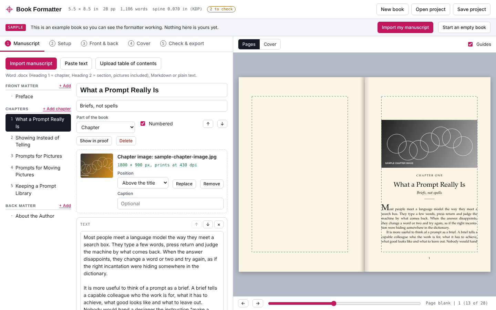
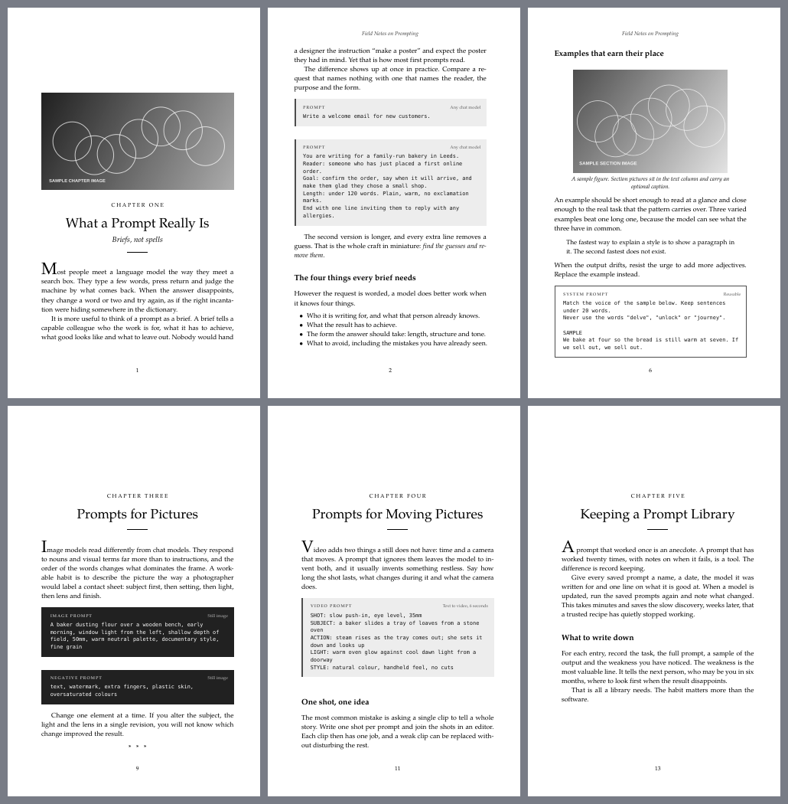
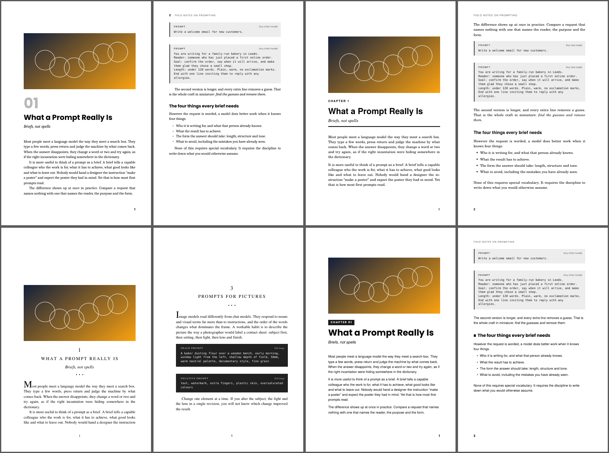
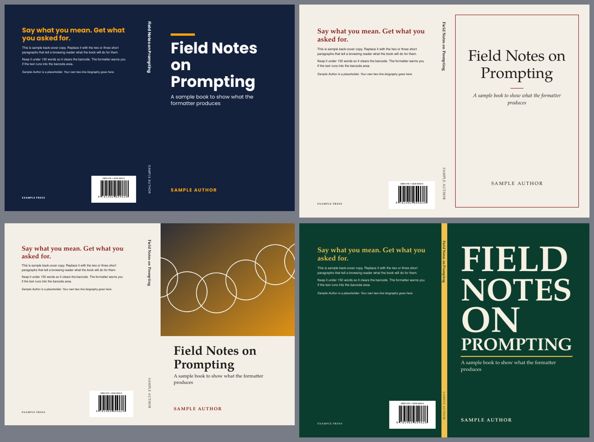
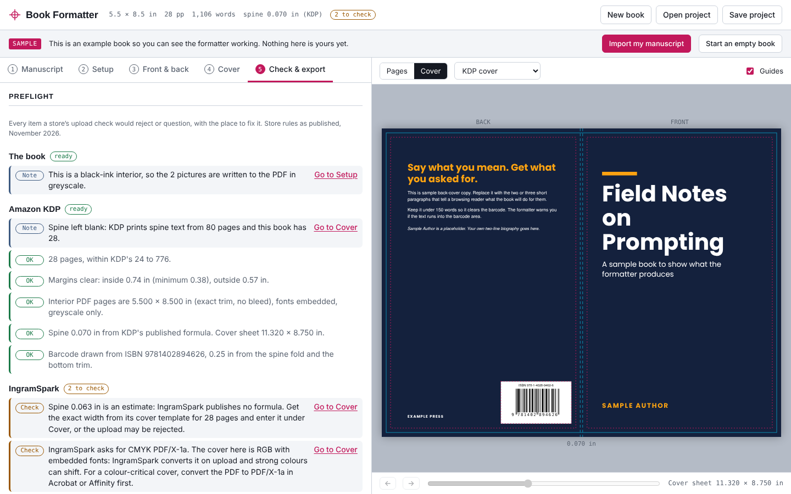

# Booksformatter

Turn one manuscript into the files every book store asks for: a print-ready interior PDF, a wrap cover with the spine and barcode worked out from the page count, an EPUB, a Word file and an ebook cover.

It runs in your browser. There is nothing to install and no account, and your manuscript never leaves your computer.

**[Open the app](https://donsajith.github.io/Booksformatter/)** · [Example files](examples/output) · [Manuscript format](docs/MANUSCRIPT-FORMAT.md) · [Use it with ChatGPT, Claude or another AI](docs/USING-WITH-AI.md)



## What it makes

| File | For |
|---|---|
| Interior PDF, one per store | Amazon KDP, IngramSpark, Lulu, Draft2Digital, Barnes & Noble Press, BookVault |
| Wrap cover PDF, one per store | Back, spine and front in one sheet, with bleed and an ISBN barcode |
| EPUB 3 | Kindle, Kobo, Apple Books, Draft2Digital, B&N |
| Word .docx | Editors and proofreaders |
| Ebook cover, 1656 × 2560 px JPEG | Ebook store listings |
| Preflight report | A list of what each store would reject or question |

The paperback and the ebook come from the same manuscript in the same run, so they cannot drift apart.

## Examples

Everything below was produced from [`examples/manuscript.md`](examples/manuscript.md), a short sample book. Open the real files in [`examples/output`](examples/output).

**Interior pages.** Chapter openers with a supporting image, section headings, a figure with a caption, and prompt boxes in three looks.



**Interior styles.** Six styles, each with matched fonts: Classic, Modern, Non-fiction, Literary, Readable and Prompt handbook. Four of them:



**Wrap covers.** Four templates. The spine width comes from the page count and paper, and spine text appears only when the store allows it for that thickness.



**Preflight.** Each store gets its own checks, and each problem links to the place to fix it.



## How to use it

1. **Open the app.** Use the link above, or download [`index.html`](index.html) and open it in Chrome, Edge, Firefox or Safari. It opens with a sample book so you can see every feature working.
2. **Bring in your manuscript** (tab 1, Manuscript). Import a Word .docx (Heading 1 = chapter, Heading 2 = section, pictures included), a Markdown or text file, or paste the text. You can also upload your table of contents to set the chapter structure.
3. **Add pictures and prompt boxes.**
   - Each chapter has a slot for a supporting image. Place it above the title, below it, or on a full page before the chapter.
   - Each section has an **Add image to this section** button.
   - **Prompt box** places a boxed, monospaced block for a prompt the reader will type into an AI tool. Give it a label (Prompt, Image prompt, Video prompt, Negative prompt and so on), an optional tool name, and a look. Its text is never re-quoted or hyphenated.
4. **Set up the book** (tab 2, Setup). Choose the stores, one of 18 trim sizes, the paper, and an interior style. Margins, gutter and bleed are worked out from the trim size, the page count and the strictest store you picked. You can type your own margins instead.
5. **Front and back matter** (tab 3). Half title, title page, copyright page, dedication, epigraph and a table of contents with real page numbers.
6. **Design the cover** (tab 4). Pick a template and colours, or drop in finished cover art. Add the back-cover text and your ISBN for the barcode.
7. **Check and export** (tab 5). Read the preflight list, fix anything marked Fix, then press **Build all files** and save them one by one or as a single zip.

Use **Save project** to keep your work as a file, and **Open project** to carry on later.

## Use it with ChatGPT, Claude or another AI

Booksformatter is not a chatbot plug-in. It is a web page, so anyone can use it without an AI at all. An AI assistant helps in two ways:

- **Any chat assistant** can convert your draft into the Booksformatter manuscript format. Paste the result into the app and export. The ready-made prompt is in [docs/USING-WITH-AI.md](docs/USING-WITH-AI.md).
- **Assistants that can run code** (Claude Code, Codex, Cursor and similar) can build the files for you with the command line below. Point them at this repository and tell them what you want; [AGENTS.md](AGENTS.md) tells them how.

## Command line

For scripts and AI agents. Needs [Node.js](https://nodejs.org) 18 or later and nothing else.

```
git clone https://github.com/donsajith/Booksformatter.git
cd Booksformatter
node cli.mjs examples/manuscript.md --out my-files
```

```
node cli.mjs my-book.md --stores kdp,lulu --trim 6x9 --paper cream --style business
node cli.mjs --list      # every trim size, style, paper, store and cover template
node cli.mjs --help
```

The command line reads Markdown or plain text and places JPEG pictures. Three things only the browser app does: importing Word files, converting colour pictures to greyscale for black-ink interiors, and drawing the ebook cover image.

## Stores

| Store | Spine width | Notes |
|---|---|---|
| Amazon KDP | Exact, from KDP's published formula | 24 to 828 pages depending on paper |
| Lulu | Exact, from Lulu's published formula | Interior pages carry bleed on all four sides |
| IngramSpark | Estimate | Wants a barcode and a blank last page; asks for CMYK PDF/X-1a |
| Draft2Digital | Estimate | Black-and-white interiors, 64 to 740 pages |
| Barnes & Noble Press | Estimate | 18 to 800 pages |
| BookVault | Estimate | Millimetre sizes, 3 mm bleed |

Where the spine is an estimate, the store does not publish a formula. Take the width from the store's own cover template and enter it under Cover before you upload.

## Limits

- PDFs are RGB or greyscale with every font embedded. They are not CMYK PDF/X-1a, which IngramSpark asks for. For a colour-critical cover, convert the PDF first.
- Paperbacks only. There are no hardcover case or dust jacket templates.
- Left-to-right Latin-script text. The bundled fonts do not cover Arabic, Hebrew or CJK scripts.
- The EPUB has been checked for structure but not run through EPUBCheck. Validate it before a wide release.
- Store rules were checked against the stores' help pages in November 2026. Stores change them, so confirm before you order copies.

## For developers

The app is plain JavaScript with no dependencies. `build.py` bundles `src/` into the single `index.html`.

```
python3 build.py                 # rebuild index.html after changing anything in src/
npm test                         # engine tests and a command-line run
python3 test/browser.py build    # full export in headless Chromium (needs Playwright)
```

| Path | What it is |
|---|---|
| `src/specs.js` | Store rules, trim sizes, papers, interior styles, margin and spine maths |
| `src/core.js` | PDF writer, font handling, zip, helpers |
| `src/layout.js` | Pagination and typesetting |
| `src/cover.js` | Wrap cover layout and EAN-13 barcode |
| `src/export.js` | Interior and cover PDF, EPUB and DOCX builders |
| `src/import.js` | Word, Markdown and text import; manuscript header; table-of-contents upload |
| `src/preflight.js` | Per-store checks |
| `src/ui-core.js`, `src/ui-panes.js`, `src/index.template.html` | The app screens |
| `src/fonts.js`, `src/hyph.js` | Embedded fonts and hyphenation patterns, generated by `build_fonts.py` |
| `cli.mjs` | Command line |

Store rules live in `src/specs.js`. If a store changes a rule, that is the file to update.

## Licence

The code is released under the [MIT Licence](LICENSE).

The embedded fonts and hyphenation patterns keep their own open licences. See [THIRD-PARTY-NOTICES.md](THIRD-PARTY-NOTICES.md).
